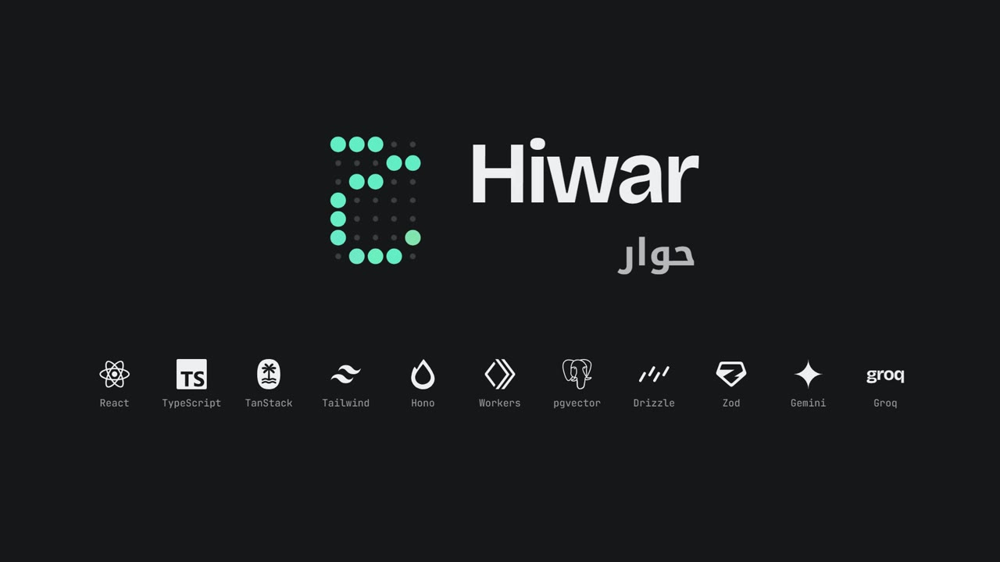

<div align="center">

<a href="docs/media/hiwar.mp4"></a>

**A personal AI chat that is bilingual by construction.**
Arabic and English in one sentence, and nothing breaks.

[Watch the 35-second showcase](docs/media/hiwar.mp4) · [Architecture](docs/architecture.md) · [Design system](DESIGN.md)

</div>

## What it does

- **Arabic is never second.** Direction is set per paragraph by majority script, so mixed sentences read correctly; the whole UI mirrors, and code stays left to right.
- **Streams fast.** Deltas are batched into one render per animation frame, the UI is optimistic, and Stop saves what was written.
- **Remembers you.** Facts from your own messages are embedded and recalled in later chats. You can review and delete every one, and edit profile facts.
- **Searches the web.** A `web_search` tool call returns sources as numbered citations.
- **Draws when a picture helps.** Function plots, charts, timelines, comparisons, cycles, trees, and Mermaid, Graphviz and Markmap diagrams, all themed from the app's own tokens.
- **Costs nothing to run.** Free model tiers (Gemini, with Groq as fallback) on the Cloudflare Workers free plan.

## Stack

React 19 · TanStack Router and Query · Tailwind v4 · Hono on Cloudflare Workers · Neon Postgres with pgvector, through Hyperdrive · Drizzle · Workers AI embeddings · Zod · Bun

## Run it

You need [Bun](https://bun.sh), a Postgres database with the `vector` extension (a free [Neon](https://neon.tech) project works) and a Cloudflare account.

```sh
bun install
cp .env.example .env              # DATABASE_URL, for migrations and tests
cp .dev.vars.example .dev.vars    # model and search keys for the Worker
bun run db:migrate
bun run dev
```

`LLM_PROVIDERS=mock` streams canned replies, so the UI works with no API keys at all. Set it to `gemini,groq` and add the keys for real answers. Web search needs a [Tavily](https://tavily.com) key.

To deploy, create a Hyperdrive config for your database, put its id in `wrangler.jsonc`, and add the keys with `wrangler secret put`.

Pushes to `main` deploy through Cloudflare Workers Builds with `bun run deploy:ci`: it applies pending migrations to the production database (the `DATABASE_URL` build secret, a direct non-pooled Neon URL), then builds and deploys. A failed migration stops the deploy. Migrations run before the new code is live, so keep them additive: add columns and tables, and drop old ones only in a later release.

## Quality

```sh
bun run check   # biome, typecheck, tests, production build
```

Models were chosen with `scripts/eval.ts`, a fixed Arabic, English and mixed test set; the results are in [docs/evals](docs/evals).

## Layout

```
src/       React app: routes, feature folders (chat, sidebar, settings), i18n, styles
worker/    API: chat stream, LLM gateway, memory, web search, database
shared/    SSE event schemas and parsing, used by both sides
scripts/   model evaluation
brand/     the dot-matrix ح mark
```
