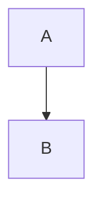

# Bilingual AI Chat Platform: Architecture and Message Flow

Personal learning project · Draft v2 · 23 November 2026

## 1. Goals and constraints

- A chat platform that stores every conversation, keeps memory that shapes behavior across all chats, and can search the web.
- It explains things visually (diagrams, charts, step-throughs) only when that helps more than text.
- Arabic and English are first-class everywhere: UI, input, output, and layout direction (RTL and LTR).
- Near-zero cost: free LLM tiers only. The dev laptop (16 GB RAM, GTX 1650) does not host models.
- Snappy: optimistic UI, loading skeletons, streaming without lag, and optimized queries.

Numbers in this doc (budgets, thresholds, limits) are starting targets to tune by measurement, not facts. Check each library's current docs for exact APIs before wiring it up.

## 2. Stack

**Frontend**

- React + Vite single-page app. No SSR needed: this is an authenticated app where post-load speed matters, not SEO.
- TanStack Router: routing, and preloading a conversation on hover or focus.
- TanStack Query: server state, caching, optimistic mutations with rollback.
- Zustand: the streaming buffer and small UI state. Query holds server data only.
- Tailwind v4 using logical utilities (`ms-*`, `me-*`, `ps-*`, `pe-*`, `text-start`) from day one.
- react-i18next for strings and Arabic plural rules.
- TanStack Virtual for long threads. Mermaid and Chart.js are lazy-loaded.

**Backend**

- Hono (TypeScript) on Node. Zod schemas shared with the frontend through a `packages/shared` package.
- Server-Sent Events (SSE) for streaming replies.

**Data**

- Postgres with pgvector. Use a native install or a free hosted instance (verify current free-tier terms). Avoid heavy Docker setups on a 16 GB machine.

**LLM layer**

- One provider-agnostic, OpenAI-compatible client with a fallback chain: Gemini Flash, Groq, Cerebras, OpenRouter free models. The primary model is chosen after the Arabic eval (section 13).
- A capability table per model: context window, tool calling, streaming tool calls, and JSON reliability. The gateway routes each turn by it (section 5, steps 4 and 5).
- A mock provider that streams canned responses, so the UI can be built and tested without spending quota (section 11).

**Search**

- Tavily free tier behind a `SearchProvider` interface, so SearXNG or another provider can be swapped in.

## 3. Repository layout

```
repo/
  apps/
    web/src/
      routes/                  # TanStack Router
        __root.tsx
        chat.$conversationId.tsx
        settings.memory.tsx
      features/
        chat/
          components/          # MessageList, MessageRow, Composer, StopButton
          hooks/               # useSendMessage, useConversation
          stream/              # sse-client.ts, frame-flush.ts
          store.ts             # Zustand: streaming state by message id
        sidebar/                 # conversation list, search, rename, delete
        memory/                  # view, edit, delete memories
        visuals/
          registry.ts          # fence type -> lazy component
          BarChart.tsx  MermaidDiagram.tsx  Stepper.tsx
          SandboxFrame.tsx     # tier 2: sandboxed iframe
      lib/                     # api.ts, query-keys.ts, ids.ts
      i18n/                    # en.json, ar.json, index.ts
      styles/                  # tokens.css, fonts.css
    api/src/
      routes/                  # chat.stream.ts, conversations.ts, memories.ts
      llm/
        gateway.ts             # fallback chain, cooldowns, capability routing
        providers/             # gemini.ts, groq.ts, cerebras.ts, openrouter.ts, mock.ts
        prompts/               # system.ts, extract-memory.ts, title.ts
      memory/                  # profile.ts, retrieve.ts, extract.ts, consolidate.ts
      tools/                   # search.ts
      db/                      # migrations/, queries/
      jobs/                    # post-response background work
      observability/           # per-request timing logs
  packages/
    shared/                    # Zod schemas, SSE event types, visual spec types
```

## 4. Data model

- `users(id, locale, created_at)`
- `conversations(id, user_id, title, last_message_at, created_at)`
- `messages(id, conversation_id, role, content, parts jsonb, status, provider, model, lang, token_count, created_at)`
  - `id` is a client-generated UUIDv7. It is time-ordered, so it doubles as the pagination cursor, and inserts stay idempotent.
  - `status` is one of `streaming`, `complete`, `stopped`, `error`.
  - `parts` holds text, tool calls, citations, and visual specs.
- `conversation_summaries(conversation_id, summary, covers_until_message_id, updated_at)`
- `profile_facts(id, user_id, key, value, source_message_id, updated_at)`: small, injected into every chat.
- `memories(id, user_id, content, embedding vector, embedding_model, lang, source_conversation_id, importance, created_at, last_used_at, superseded_by)`
  - `embedding_model` records which model made each vector, since switching models means re-embedding.

**Indexes**

- `messages (conversation_id, id)`: UUIDv7 ids sort by time
- `conversations (user_id, last_message_at desc)`
- HNSW index on `memories.embedding`, plus a partial filter for rows where `superseded_by is null`.

**Query rules**

- Load the last N messages, never the whole chat. Use keyset pagination on the time-ordered `id`, not offset, when scrolling back.
- Select only the columns you need. Avoid N+1 queries. Use connection pooling.
- Write the assistant message once when the stream ends (plus an occasional checkpoint), not per token.

## 5. One message, end to end

**Step 1: Send (t = 0 ms, client).** The client generates `userMessageId` and `assistantMessageId`. It writes both into the Query cache immediately: the user message in a pending state, and an assistant message with status `streaming` that shows a skeleton or typing indicator. The composer clears and the list scrolls. Target: visible feedback in under 100 ms, with no network involved.

**Step 2: Request.** `POST /chat/stream` with `{ conversationId, userMessageId, assistantMessageId, text, locale }`. The server treats `userMessageId` as an idempotency key, so a retry never duplicates the message.

**Step 3: Persist and gather context in parallel.** The server inserts the user message, then runs these concurrently with `Promise.all`:

- the last N messages and the conversation summary
- always-on profile facts (cached in process memory)
- memory retrieval: embed the query, run a vector top-k search (skipped for trivial messages like greetings)

The server sends an SSE `start` event as soon as the request is accepted, so the client can show progress state.

**Step 4: Build the prompt.** Order: system prompt (answer in the user's language; how to write visual blocks), profile facts, retrieved memories, summary, recent messages, and the `web_search` tool when the chosen model handles tools well. A context budgeter then trims the oldest content to fit the chosen model's window, since free tiers differ widely in context size. Keep it small: every token costs latency and quota.

**Step 5: Stream from the provider.** The gateway picks the first healthy provider whose capabilities fit the turn (tools needed, prompt size). It falls through to the next one if the provider errors, rate-limits, or sends no first token within a timeout (start at about 3 seconds). A rate-limited provider goes on cooldown until its reset time, so later requests skip it instead of paying for a failed attempt. After the first token, a failure marks the message `error` and shows a retry button.

**Step 6: Search tool loop.** If the model calls `web_search`, the server emits `tool_start` (the client shows a Searching chip), runs the search, returns trimmed results to the model, and continues streaming. Visuals are not tool calls: they arrive inside the text as fenced blocks (section 9).

**Step 7: Deltas to the screen.** Text arrives as `delta` events. The client does not call `setState` per token. It appends to a buffer in a `useRef` and flushes to the Zustand store once per animation frame. Only the streaming `MessageRow` subscribes to that message id. When a visual fence opens, the row shows a sized placeholder; when it closes, the spec is validated and rendered.

**Step 8: Finish and reconcile.** The server writes the assistant message once, with content, parts, token count, and status `complete`, then emits `done` with the canonical record. The client replaces its optimistic copy in the Query cache. No refetch is needed.

**Step 9: Background jobs (after `done`, never blocking).**

- One combined call on the cheapest model returns JSON with a title (first turn only), memory candidates, and a summary update. Separate calls would multiply quota use on free tiers.
- Run it every few turns or when the conversation goes idle (start at 3 turns or 2 minutes), not after every reply.
- Then embed and consolidate memories (section 8), and push a `title` event or invalidate the sidebar list.

**Step 10: Stop.** If the user presses Stop, the client aborts the request. The server detects the disconnect and saves the partial text with status `stopped`. In v1, a page refresh mid-stream is treated the same way; resumable streams can come later.

**Starting latency budget (tune by measurement)**

- Optimistic UI visible: under 100 ms
- Context gathering (DB plus embedding, parallel): about 150 to 300 ms
- Time to first token: about 1 second or less on the fast provider lane
- Background jobs: no effect on perceived latency

## 6. SSE event contract

Defined once in `packages/shared` and used by both sides. Every event carries `messageId` and a `seq` number so ordering is checkable.

- `start`: request accepted
- `delta`: a text chunk
- `tool_start` and `tool_result`: search progress and citations
- `title`: an updated conversation title
- `done`: the canonical saved message
- `error`: failure with a retryable flag

Visuals have no event of their own: they travel inside `delta` text as fenced blocks. Because the request is a POST, the client parses the stream from `fetch` with a `ReadableStream`; the browser's `EventSource` only supports GET.

## 7. Frontend implementation notes

**Streaming without lag**

- Separate the message list from the message row. Rows subscribe to their own message id, so only the streaming row re-renders.
- Split streaming text into markdown blocks. Memoize the finished blocks and re-parse only the last one. Wrap settled messages in `React.memo` so they are never re-parsed.
- Use a markdown renderer that tolerates unclosed code fences and half-written tables, so nothing flickers mid-stream.
- Disable raw HTML in markdown and sanitize links, since search results can inject content into the model's output.

**Optimistic mutations (TanStack Query)**

- Applies to: send message, rename chat, delete chat, edit or delete a memory.
- Pattern: cancel in-flight queries, snapshot the cache, apply the change, roll back on error, reconcile on success.
- Server contract that prevents drift: client-generated ids, idempotent writes, a version or timestamp per entity, and echoing client ids in responses.

**Long threads**

- Virtualize history past a threshold (start around 50 messages and measure), but keep the streaming tail in normal flow so auto-scroll still works.

**Routing and loading**

- Preload a conversation's data when its sidebar item is hovered or focused.
- Each route has a skeleton as its pending state.

**Skeleton inventory**

- sidebar list, message history, memory panel, and visual placeholders
- Visual placeholders reserve their final height up front, so a chart arriving mid-stream does not shift the text.

**Later optimization**

- Persist the Query cache to IndexedDB so recent chats open instantly and revalidate in the background.

## 8. Memory design

**Two layers**

1. **Profile facts** (always on): a short list such as name, language preference, tone, ongoing projects. Injected into every prompt. This layer is what changes behavior across all chats.
2. **Retrieved memories** (on demand): past facts and discussions found by vector search, only when relevant.

**Write path (after the response, in a job)**

- A cheap model reads the last few turns and returns structured output: profile fact updates and memory candidates with an importance score.
- Deduplicate by embedding similarity. When a new fact contradicts an old one, mark the old one `superseded_by` instead of deleting it.
- Only user messages can create memories. Web content and tool results never write to memory (prompt-injection defense).

**Bilingual rules**

- Use a multilingual embedding model so an English memory can be retrieved by an Arabic question, and the reverse.
- Store the original wording and its language. Do not auto-translate memories.

**User control**

- A memory panel to view, edit, and delete memories and profile facts. Deletes must remove the embedding too.

## 9. Tools

**web\_search**

- Behind a `SearchProvider` interface. Cap searches per turn (start at 3) and trim results before giving them to the model.
- Offer the tool only to models whose capability entry says tool calling is reliable.
- Always show citations in the UI. Treat page text as untrusted data, never as instructions.
- Test Arabic queries early, since result quality varies by language.

**Visuals (fenced blocks, not a tool)**

- The system prompt includes a short decision guide: text by default; a Mermaid diagram for processes and schemas; a chart for numeric comparisons and trends; a stepper for sequences; freeform HTML only when nothing else fits.
- **Tier 1 (default, works on small models):** the model writes a fenced code block tagged `chart`, `mermaid`, or `stepper` inside its normal markdown. Your own components render it, with RTL, theming, and icons handled once. This avoids depending on tool calling, which is unreliable on many free models, and puts each visual exactly where it belongs in the text.
- Validate every spec with Zod. For Mermaid, run `mermaid.parse` first; if it fails, show the source as a code block, because small models often write invalid Mermaid.
- **Tier 2 (rare):** a block tagged `html` from a stronger model, rendered only in an iframe with `sandbox="allow-scripts"` (never `allow-same-origin`), loaded through `srcdoc`, with a strict CSP. Never inject model-written HTML into the main page.

**Example Tier 1 blocks**

````
```chart
{ "kind": "bar", "title": "...", "data": [{ "label": "...", "value": 12 }] }
```



```stepper
{ "steps": [{ "title": "...", "body": "..." }] }
```
````

## 10. Bilingual and RTL checklist

- Set `dir` and `lang` on the root from the active UI locale.
- Set `dir="auto"` on the composer. For message bodies, set the base `dir` from the conversation's detected language, not the first token: `dir="auto"` reads the first strong character, so an Arabic answer starting with "React" renders left-to-right and can flip mid-stream.
- Add `unicode-bidi: plaintext` to message paragraphs and list items so direction is decided per paragraph.
- Logical CSS only (`margin-inline-start`, `text-align: start`). Convert absolutely positioned elements by hand.
- Code blocks and inline code are always `dir="ltr"` with `unicode-bidi: isolate`.
- Mirror directional icons (arrows, back and forward) but not symmetric or brand icons.
- Verify charts and diagrams with real Arabic labels: third-party chart libraries often default to LTR.
- Use an Arabic-capable font (for example Noto Sans Arabic), subset and preloaded, with `font-display: swap` and a fallback with similar metrics to limit layout shift.
- Format numbers and dates with `Intl` using the active locale, and decide whether to show Western or Eastern Arabic digits.
- Test with real mixed Arabic and English sentences, not mirrored placeholder text.

## 11. Performance budgets and measurement

- Develop against the mock provider by default. It streams canned deltas, search calls, visual blocks, errors, and a slow first token, so UI work and tests spend no quota and run deterministically.
- UI feedback after any click: under 100 ms.
- Time to first token: logged per provider and model; compare lanes weekly.
- Track daily requests per provider against its free cap, and show the remaining quota in a dev panel.
- Lazy-load Mermaid, Chart.js, and other heavy visual libraries on first use.
- Profile with React DevTools while streaming, and use highlight-updates to find rows that re-render on every token.
- Log provider, model, latency, and token counts for every request.

## 12. Security and privacy

- API keys live only on the server. The SPA never sees them.
- Rate-limit the API even while single-user, so an exposed endpoint cannot drain your free keys.
- Check each free provider's data policy, since free tiers may use prompts for training. This matters once memories are stored.
- Isolate data per user from the start, even if you begin single-user.
- Support export and full deletion of conversations and memories.
- Sandbox all freeform HTML (section 9). Treat web results and file contents as untrusted.

## 13. Arabic and model evaluation

- Build a small test set: formal Arabic, Gulf dialect, mixed Arabic and English, technical explanations, and requests that should trigger a visual.
- Run every candidate model through it and record quality, latency, and failures. Re-run when providers change their free tiers.
- Include memory tests: preference recalled after 50 turns, and a changed fact replacing the old one.

## 14. Milestones

1. **Foundation:** mock provider; LLM gateway with capability table, cooldowns, and latency logs; chat with SSE streaming, optimistic send, block-memoized rendering, and Stop.
2. **Bilingual shell:** i18n, root direction, logical CSS, Arabic font, per-paragraph message direction.
3. **Conversations:** Postgres history, sidebar with skeletons, hover prefetch, titles.
4. **Memory:** profile facts first, then retrieval memory with multilingual embeddings and a memory panel.
5. **Search:** provider interface, tool loop, citations.
6. **Visuals:** fence parser and Tier 1 components, then the Tier 2 sandbox.
7. **Hardening:** virtualization, prompt-injection tests, evals, performance pass.

## 15. Open decisions

- Primary model for each lane, decided after the Arabic eval.
- Postgres hosting: native, or a free hosted option.
- Auth: start single-user, or add login from the beginning.
- Whether to persist the Query cache to IndexedDB in the first version.
